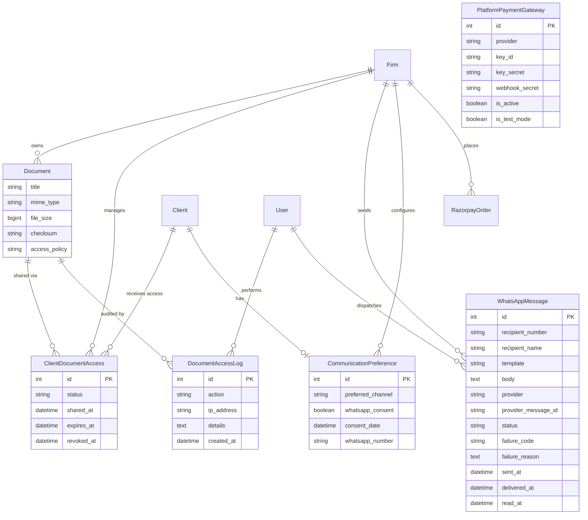

# Git Commit Range Analysis & Complete Flutter Implementation Guide

**Document Version:** 1.0.0  
**Generated Date:** 2026-10-16  
**Repository Analyzed:** `legal_management_system`  
**Base Commit:** `afbe6e16dcbf43bcf514db0e1b4fbfaf509661e1`  
**Target Commit:** `fa64f951c9247eb4aa1aeba8d86af492ba8db7e5`  
**Scope:** Read-only architectural and technical delta analysis for reproducing verified functionality in an existing Flutter client application.

---

## Section A: Executive Summary

### 1. Commit Range Overview
This document provides a comprehensive technical analysis of all net changes introduced between Git commits `afbe6e16dcbf43bcf514db0e1b4fbfaf509661e1` (Base) and `fa64f951c9247eb4aa1aeba8d86af492ba8db7e5` (Target) in the `legal_management_system` repository.

The commit range consists of two sequential commits by author Kumkum Maurya on 2026-10-16:
1. `2173d3a861c43688c671c77f55c8add3b39fccda` (*"new"*): Frontend React (Vite/MUI) overhaul introducing client portal views, shared UI state components, error interceptors, WhatsApp composer, document preview modal, and admin subscription management.
2. `fa64f951c9247eb4aa1aeba8d86af492ba8db7e5` (*"new"*): Backend Django/DRF overhaul introducing the unified exception handling middleware, request ID tracking, document security pipeline (SHA-256 checksums, access audit logs, signed token downloads), client portal API endpoints, WhatsApp communication module (Twilio and Click-to-Chat providers, message templates, webhook handler), firm access control with subscription paywall enforcement, and super-admin payment gateway configuration.

### 2. Core Purpose of the Changes
The commit range transitions the platform from a purely internal firm-facing back-office tool into a multi-sided legal operations platform featuring:
- **Client Document Portal:** End-clients can be invited, accept tokens, log in with dedicated credentials, view assigned case hearings and legal counsel, inspect case documents, and securely download/preview files.
- **Document Access Control & Security:** Firm lawyers can selectively share or revoke specific documents to clients with optional expiration timers; uploads compute cryptographic SHA-256 checksums and enforce 25MB limits with MIME validation; all document operations generate immutable audit logs (`DocumentAccessLog`).
- **Standardized Error Envelope & Request Tracing:** All API errors across Django REST Framework are standardized into a uniform schema with a correlation `requestId` and machine-readable error codes.
- **Firm Subscription & Workspace Paywall:** Firm access permissions (`FirmAccessPermission`) enforce firm status and active subscription deadlines. Inactive or blocked firms and expired subscriptions block workspace operations, with firm admins restricted to subscription renewal views.
- **WhatsApp Communications:** Direct messaging integration supporting pre-configured templates (hearing reminders, document shares, case updates, payment reminders) via Twilio or click-to-chat fallback (`wa.me`), backed by client consent preferences.
- **Platform Payment Gateway Configuration:** Super-admins can configure platform-wide Razorpay credentials in the database rather than relying on static environment files, and monitor transactions.

### 3. Dependencies Between Features
```
[RequestIdMiddleware + CustomExceptionHandler] (Foundation)
       │
       ├──> [FirmAccessPermission & Subscription Guard] (Security Foundation)
       │           │
       │           ├──> [Client Portal Auth & Document Access] (Feature 1 & 2)
       │           │           │
       │           │           └──> [Document Preview & Signed Token Download]
       │           │
       │           ├──> [WhatsApp Communication Engine] (Feature 4)
       │           │
       │           └──> [Platform Payment Gateway & Razorpay Orders] (Billing)
```

### 4. Recommended Flutter Implementation Order
1. **Network Layer Foundation:** Standardize HTTP response parsing, request ID header extraction (`X-Request-ID`), and global error interception for `FIRM_BLOCKED` and `SUBSCRIPTION_EXPIRED`.
2. **Client Authentication & Profile Routing:** Support client-specific JWT authentication (`/api/client-portal/login/`) and invite acceptance (`/api/client-portal/accept-invite/`).
3. **Firm Paywall & Subscription Handling:** Display dedicated blocking screens when HTTP 403 error codes `FIRM_BLOCKED` or `SUBSCRIPTION_EXPIRED` are received.
4. **Client Portal Dashboard & Hearings:** Implement client representation overview and upcoming hearings (`/api/client-portal/hearings/`).
5. **Secure Document Browser, Signed Link Download & In-App Preview:** Implement shared document listing (`/api/client-portal/documents/`), token generation (`/api/client-portal/documents/<id>/access-link/`), file downloading, and PDF/image preview.
6. **Firm-Side Document Sharing (Lawyer/Admin role in Flutter):** Document sharing management panel (`/api/clients/<id>/shared-documents/`).
7. **WhatsApp Communication Dispatcher:** Messaging dialog for sending template-based reminders with WhatsApp URL launch or Twilio API trigger.

---

## Section B: Git Change Inventory

### 1. Commit Log in Inspected Range
```
* fa64f95 (HEAD -> main, origin/main) new (Kumkum Maurya, 2026-10-16 15:46:05 +0530)
* 2173d3a new (Kumkum Maurya, 2026-10-16 15:39:09 +0530)
* afbe6e1 (base commit)
```

### 2. Modified & Added File Classification
| File Path | Action | Type | Functional Impact |
|---|---|---|---|
| `legal_management_system/settings.py` | Modified | Backend Config | Added `RequestIdMiddleware`, global exception handler, Twilio config, logging config, allowed hosts. |
| `legal_management_system/urls.py` | Modified | Backend Routing | Registered client portal routes, sharing routes, WhatsApp routes, schema docs, SPA fallback. |
| `legal_management_system/utils/request_id_middleware.py` | Added | Backend Middleware | Generates `req_<uuid16>`, attaches thread-local ID, sets `X-Request-ID` header. |
| `legal_management_system/utils/exception_handler.py` | Added | Backend Exception Handler | Catches all DRF exceptions and unhandled 500s; outputs standardized `{ success: false, error: {...} }`. |
| `legal_management_system/utils/views.py` | Modified | Backend Base View | Enforces `FirmAccessPermission` in `FirmBaseViewSet.initial()`. |
| `accounts/models.py` | Modified | Backend Model | Added `'client'` to `UserProfile.ROLE_CHOICES` and `Invite.TYPE_CHOICES`. |
| `accounts/permissions.py` | Modified | Backend Permissions | Implemented `FirmAccessPermission` (checks blocked status and subscription expiration). |
| `accounts/views.py` | Modified | Backend Auth | Login endpoint returns firm block status, expiration flags, and subscription details. |
| `accounts/client_views.py` | Added | Backend Views | Client invite (`ClientInviteView`), accept invite (`ClientAcceptInviteView`), client login (`ClientLoginView`). |
| `accounts/migrations/0006_alter_userprofile_role.py` | Added | Backend Migration | Migration adding 'client' choice to `UserProfile.role`. |
| `accounts/migrations/0007_alter_invite_invite_type.py` | Added | Backend Migration | Migration adding 'client' choice to `Invite.invite_type`. |
| `cases/client_views.py` | Added | Backend Views | `ClientHearingsView`: Client dashboard data (cases, next hearing, court schedules, lawyers, firm info). |
| `documents/models.py` | Modified | Backend Model | Added `title`, `mime_type`, `file_size`, `checksum`, `access_policy` to `Document`; created `DocumentAccessLog`, `ClientDocumentAccess`. |
| `documents/security.py` | Added | Backend Security | SHA-256 calculation, MIME/extension verification, signed download token generator/verifier, audit logger. |
| `documents/views.py` | Modified | Backend Views | File validation and checksum on upload, audit logging, inline `preview` action. |
| `documents/client_views.py` | Added | Backend Views | `ClientDocumentListView`, `ClientDocumentDetailView`, `ClientDocumentAccessLinkView`, `ClientDocumentDownloadView`. |
| `documents/share_views.py` | Added | Backend Views | `ShareDocumentView`, `RevokeDocumentView`, `SharedDocumentsListView`. |
| `documents/migrations/0003_document_access_policy_document_checksum_and_more.py` | Added | Backend Migration | Migration creating `DocumentAccessLog`, `ClientDocumentAccess`, and Document fields. |
| `messaging/models.py` | Modified | Backend Model | Imports `WhatsAppMessage` and `CommunicationPreference`. |
| `messaging/whatsapp_models.py` | Added | Backend Model | Models for `WhatsAppMessage` (statuses, templates, provider logs) and `CommunicationPreference`. |
| `messaging/whatsapp_provider.py` | Added | Backend Service | Provider abstraction (`TwilioWhatsAppProvider`, `ClickToChatProvider`, factory `get_whatsapp_provider`). |
| `messaging/whatsapp_templates.py` | Added | Backend Templates | Predefined message formatters for hearings, shared documents, updates, payments, and general alerts. |
| `messaging/whatsapp_views.py` | Added | Backend Views | `SendWhatsAppMessageView`, `WhatsAppMessageStatusView`, `WhatsAppWebhookView`, `CommunicationPreferenceView`, `WhatsAppTemplatesView`. |
| `messaging/migrations/0002_communicationpreference_whatsappmessage.py` | Added | Backend Migration | Migration creating `WhatsAppMessage` and `CommunicationPreference`. |
| `adminpanel/urls.py` | Modified | Backend Routing | Added routes for payment gateway management and subscription transactions. |
| `adminpanel/views.py` | Modified | Backend Views | Added `AdminPaymentGatewayView` (Razorpay config) and `AdminSubscriptionTransactionsView`. |
| `subscriptions/models.py` | Modified | Backend Model | Added `PlatformPaymentGateway`; added `firm` foreign key to `RazorpayOrder`. |
| `subscriptions/views.py` | Modified | Backend Views | Enhanced `FirmSubscriptionViewSet.active` returning active status, days remaining, firm block status. |
| `subscriptions/razorpay_views.py` | Modified | Backend Views | Dynamic Razorpay client resolving DB credentials from `PlatformPaymentGateway`; order linking to firm. |
| `subscriptions/migrations/0005_platformpaymentgateway_razorpayorder_firm.py` | Added | Backend Migration | Migration creating `PlatformPaymentGateway` and `RazorpayOrder.firm`. |
| `nts-admin/src/App.jsx` | Modified | Frontend Routing | Client portal routing (`/client/login`, `/client/accept-invite`, `/client/dashboard`), role conditional dashboard routing. |
| `nts-admin/src/api/client.js` | Modified | Frontend API | Standardized error payload interceptor, `X-Request-ID` extraction, offline handling, custom event dispatching. |
| `nts-admin/src/api/services.js` | Modified | Frontend Services | Added `clientPortalAPI`, `adminPaymentGatewayAPI`, document preview, Razorpay order/payment calls. |
| `nts-admin/src/layout/AppLayout.jsx` | Modified | Frontend Layout | Paywall block enforcement in UI for `firmBlocked` and `subscriptionExpired`. |
| `nts-admin/src/layout/ClientLayout.jsx` | Added | Frontend Layout | Dedicated minimalist navigation header for client users without firm admin sidebar. |
| `nts-admin/src/pages/ClientLogin.jsx` | Added | Frontend Page | Client authentication page supporting username/email login and invite token acceptance. |
| `nts-admin/src/pages/ClientPortal.jsx` | Added | Frontend Page | Client dashboard: case overview, next hearing banner, lawyers, documents list, preview modal, signed download. |
| `nts-admin/src/pages/Clients.jsx` | Modified | Frontend Page | Client invite button, modal with activation link copy, document share management panel trigger. |
| `nts-admin/src/pages/DocumentSharePanel.jsx` | Added | Frontend Page/Component | Shared document manager for firm users (grant access, set expiration days, revoke access). |
| `nts-admin/src/pages/Documents.jsx` | Modified | Frontend Page | Integrated in-app preview dialog with iframe/image support and download triggers. |
| `nts-admin/src/pages/Plans.jsx` | Modified | Frontend Page | Pricing cards with monthly/yearly toggle, 18% GST display, Razorpay checkout dialog, active plan state. |
| `nts-admin/src/pages/AdminPlansPage.jsx` | Modified | Frontend Page | Super-admin tabs for Plan CRUD, Razorpay gateway settings, and subscription transaction audit table. |
| `nts-admin/src/components/EmptyState.jsx` | Added | Frontend Component | Standard empty state container with icon and action button. |
| `nts-admin/src/components/ErrorState.jsx` | Added | Frontend Component | Standard error display with request ID copy button and support mailto. |
| `nts-admin/src/components/FormField.jsx` | Added | Frontend Component | Form field wrapper with inline validation slide-down and required asterisk. |
| `nts-admin/src/components/LoadingState.jsx` | Added | Frontend Component | Skeletons for page, table, card, and list layouts. |
| `nts-admin/src/components/PermissionDenied.jsx` | Added | Frontend Component | Blocked firm, expired plan, and unauthorized state view. |
| `nts-admin/src/components/RazorpayCheckout.jsx` | Modified | Frontend Component | Success dialog triggers callback for immediate plan activation reload. |
| `nts-admin/src/components/SuccessToast.jsx` | Added | Frontend Component | Bottom toast with animated duration progress bar. |
| `nts-admin/src/components/WhatsAppComposer.jsx` | Added | Frontend Component | Dialog to select template, customize body, pick recipient, and send WhatsApp reminder. |

---

## Section C: Feature-by-Feature Technical Analysis

### Feature 1: Client Portal & Dedicated Client Authentication

#### 1. Purpose & User Workflow
Allows law firm clients to log in via a dedicated portal, view upcoming hearings, review assigned counsel, and access shared documents without exposing law firm administrative controls.
- **Workflow A (Invitation & Onboarding):** Lawyer/Admin inputs client email and optional note -> System generates unique single-use token -> Client receives email or lawyer copies invite URL -> Client visits activation screen -> Inputs username and password -> Account created with role `'client'` -> Auto-authenticates and redirects to Client Portal.
- **Workflow B (Portal Usage):** Client logs in with email/username and password -> Sees Next Hearing banner, Assigned Lawyers, Firm Administrator contact info, and list of Shared Documents -> Previews or downloads files.

#### 2. Base vs. Target Behavior
- **Base Commit:** Only `admin`, `lawyer`, and `staff` roles existed. Clients were plain records in the `Client` table with no login capabilities, no user profile, and no document viewing UI.
- **Target Commit:** Added `'client'` role to `UserProfile.ROLE_CHOICES` and `Invite.TYPE_CHOICES`. Created dedicated views `ClientInviteView`, `ClientAcceptInviteView`, `ClientLoginView`, and frontend layout `ClientLayout` with `ClientPortal` page.

#### 3. Database & Architecture Impact
- `accounts_invite`: Can now store `role='client'` and `invite_type='client'`.
- `accounts_userprofile`: Users can have `role='client'`. Linked to the firm via `userprofile.firm`.

---

### Feature 2: Document Security, Integrity & Audit Trail

#### 1. Purpose & User Workflow
Prevents unauthorized file access, prevents file tampering, validates uploaded file types, generates cryptographically signed time-limited download links, and logs every access event for compliance.
- **Workflow:** 
  1. Firm lawyer uploads file -> Backend checks extension and MIME type against allowed list -> File size verified (<= 25MB) -> SHA-256 hash computed -> File saved with `access_policy='firm'`.
  2. Lawyer shares document with client -> Creates `ClientDocumentAccess` record (with optional expiration). Document policy becomes `'shared'`.
  3. Client requests download/preview -> System verifies active `ClientDocumentAccess` -> Returns short-lived signed token (valid 300 seconds) -> Client fetches binary file using `token`.
  4. Audit log entry recorded in `DocumentAccessLog` for upload, download, preview, share, revoke, or denied access.

#### 2. Base vs. Target Behavior
- **Base Commit:** `Document` model had only `firm`, `case`, `file`, and `uploaded_by`. No file validation, no checksums, direct unauthenticated or unrestricted file downloads from media path.
- **Target Commit:** Full integrity validation, SHA-256 checksums, `DocumentAccessLog` table, `ClientDocumentAccess` relation table, signed token download endpoints (`/api/client-portal/documents/<id>/access-link/` and `/download/<id>/?token=...`), and inline preview action `/api/documents/<id>/preview/`.

---

### Feature 3: Standardized Error Envelope & Request ID Tracing

#### 1. Purpose & User Workflow
Provides consistent, predictable error responses across all API endpoints, hiding sensitive stack traces while giving users an actionable `requestId` to report to support.
- **Response Format:**
```json
{
  "success": false,
  "error": {
    "code": "VALIDATION_ERROR",
    "message": "Human-readable description",
    "fieldErrors": {
      "email": ["Enter a valid email address."]
    },
    "requestId": "req_a1b2c3d4e5f60718"
  }
}
```

#### 2. Base vs. Target Behavior
- **Base Commit:** Standard default DRF error formats (raw dictionaries, lists, or HTML tracebacks on 500s). No correlation IDs.
- **Target Commit:** All DRF views and unhandled exceptions are routed through `custom_exception_handler` with unique `X-Request-ID` attached by `RequestIdMiddleware`.

---

### Feature 4: Firm Access Control & Subscription Paywall Enforcement

#### 1. Purpose & User Workflow
Enforces commercial and administrative limits on law firm accounts:
- If a firm is marked `is_blocked=True` or `is_active=False`, ALL members (admins, lawyers, staff, clients) are blocked with error `FIRM_BLOCKED`.
- If a firm's subscription has expired (`end_date < now` or `is_active=False`):
  - Firm Admins can ONLY access subscription plans and payment endpoints to renew.
  - Lawyers, Staff, and Clients are blocked with error `SUBSCRIPTION_EXPIRED`.

#### 2. Base vs. Target Behavior
- **Base Commit:** `HasActiveSubscription` permission existed but was only applied to a few endpoints, with inconsistent auto-expiration.
- **Target Commit:** `FirmAccessPermission` added to `REST_FRAMEWORK['DEFAULT_PERMISSION_CLASSES']` and `FirmBaseViewSet.initial()`. Enforces strict firm suspension and subscription paywall globally across all workspace endpoints.

---

### Feature 5: WhatsApp Communication Integration

#### 1. Purpose & User Workflow
Enables law firms to send hearing reminders, document shared notices, case updates, and payment reminders directly to client WhatsApp numbers.
- **Workflow:** Lawyer selects client/case -> Opens WhatsApp Composer -> Picks template (e.g. `hearing_reminder`) -> System verifies client WhatsApp consent in `CommunicationPreference` -> If opted-in, calls `get_whatsapp_provider().send_message()` -> If Twilio is configured, sends via Twilio API; otherwise returns direct `https://wa.me/...` URL -> Stores message record in `WhatsAppMessage` -> Updates delivery status via webhook callbacks.

#### 2. Base vs. Target Behavior
- **Base Commit:** No WhatsApp integration, models, or views.
- **Target Commit:** Added `WhatsAppMessage` and `CommunicationPreference` models, `WhatsAppProvider` abstraction with Twilio and Click-to-Chat adapters, template renderer with 5 templates, webhook receiver for Twilio status updates, and UI composer component.

---

### Feature 6: Super Admin Payment Gateway & Billing Transactions

#### 1. Purpose & User Workflow
Enables platform super-administrators to manage payment gateway credentials (Razorpay API Key & Secret) in the database via the admin panel rather than static environment variables, and inspect all platform billing transactions.

#### 2. Base vs. Target Behavior
- **Base Commit:** Razorpay keys were hardcoded or read directly from Django settings. `RazorpayOrder` did not link to firms.
- **Target Commit:** `PlatformPaymentGateway` model added. Razorpay client dynamically reads database credentials with fallback to settings. `RazorpayOrder.firm` field added. Admin panel views `AdminPaymentGatewayView` and `AdminSubscriptionTransactionsView` implemented.

---

## Section D: Exact API Contract Documentation

### 1. Client Portal Authentication & Onboarding

#### Endpoint 1.1: Client Login
- **Method:** `POST`
- **Path:** `/api/client-portal/login/`
- **Auth:** Public (`AllowAny`)
- **Headers:** `Content-Type: application/json`
- **Request Body:**
```json
{
  "username": "client_or_email@example.com",
  "password": "SecurePassword123"
}
```
*(Note: View supports both username and email in the `username` field).*
- **Success Response (200 OK):**
```json
{
  "access": "eyJhbGciOiJIUzI1NiIsIn...",
  "refresh": "eyJhbGciOiJIUzI1NiIsIn...",
  "user": {
    "id": 14,
    "username": "john_doe",
    "email": "john@example.com",
    "role": "client",
    "firm": 2,
    "firm_name": "Apex Legal Associates"
  }
}
```
- **Error Responses:**
  - `401 Unauthorized`: `{"error": "Invalid credentials."}`
  - `403 Forbidden`: `{"error": "This login is for clients only. Please use the main login."}` (if user has role other than client).

---

#### Endpoint 1.2: Validate Client Invite Token
- **Method:** `GET`
- **Path:** `/api/client-portal/accept-invite/?token={token}`
- **Auth:** Public (`AllowAny`)
- **Query Parameters:**
  - `token` (string, required): The invitation UUID token.
- **Success Response (200 OK):**
```json
{
  "valid": true,
  "is_used": false,
  "email": "client@example.com",
  "firm_name": "Apex Legal Associates",
  "suggested_username": "client"
}
```
- **Error Responses:**
  - `400 Bad Request`: `{"valid": false, "is_used": true, "email": "...", "error": "This invitation link has already been used. Please log in with your credentials."}`
  - `404 Not Found`: `{"valid": false, "error": "Invalid invitation link."}`

---

#### Endpoint 1.3: Accept Client Invite & Create Account
- **Method:** `POST`
- **Path:** `/api/client-portal/accept-invite/`
- **Auth:** Public (`AllowAny`)
- **Request Body:**
```json
{
  "token": "4a18f8e7-6a1c-4b53-b91c-123456789abc",
  "username": "client_john",
  "password": "NewSecurePassword123",
  "first_name": "John",
  "last_name": "Doe"
}
```
- **Success Response (201 Created):**
```json
{
  "message": "Account created successfully.",
  "access": "eyJhbGciOiJIUzI1NiIsIn...",
  "refresh": "eyJhbGciOiJIUzI1NiIsIn...",
  "user": {
    "id": 15,
    "username": "client_john",
    "email": "client@example.com",
    "role": "client",
    "firm": 2,
    "firm_name": "Apex Legal Associates"
  }
}
```
- **Error Responses:**
  - `400 Bad Request`: `{"error": "This username is already taken by another account. Please choose a different username."}`
  - `400 Bad Request`: `{"error": "This invitation link has already been used. Please log in with your credentials."}`

---

#### Endpoint 1.4: Send Client Invite (Firm Lawyer/Admin)
- **Method:** `POST`
- **Path:** `/api/client-portal/invite/`
- **Auth:** Bearer Token (Role: `admin` or `lawyer`)
- **Request Body:**
```json
{
  "email": "client@example.com",
  "client_name": "John Doe",
  "message": "Welcome to our portal. Review your case documents here."
}
```
- **Success Response (201 Created or 200 OK for re-invite):**
```json
{
  "message": "Client invitation sent successfully.",
  "invite_id": 8,
  "invite_url": "http://localhost:5173/client/accept-invite?token=4a18f8e7-6a1c-4b53...",
  "token": "4a18f8e7-6a1c-4b53...",
  "email_sent": true
}
```
- **Error Responses:**
  - `400 Bad Request`: `{"detail": "A client portal account already exists for this email."}`

---

### 2. Client Portal Workspace & Documents

#### Endpoint 2.1: Client Dashboard Hearings & Counsel Info
- **Method:** `GET`
- **Path:** `/api/client-portal/hearings/`
- **Auth:** Bearer Token (Role: `client`)
- **Success Response (200 OK):**
```json
{
  "client_name": "John Doe",
  "client_email": "john@example.com",
  "firm": {
    "id": 2,
    "name": "Apex Legal Associates",
    "email": "contact@apexlegal.com",
    "phone": "+91 9876543210",
    "whatsapp": "+919876543210",
    "address": "Suite 401, High Court Road, Shimla"
  },
  "firm_admins": [
    {
      "id": 3,
      "name": "Maulik Sharma",
      "username": "msharma",
      "email": "admin@apexlegal.com",
      "role": "Firm Administrator"
    }
  ],
  "assigned_lawyers": [
    {
      "id": 5,
      "name": "Adv. Rajesh Kumar",
      "username": "rajesh_law",
      "email": "rajesh@apexlegal.com",
      "case_title": "Sharma vs Union of India (#C-2026/091)",
      "role": "Assigned Lawyer"
    }
  ],
  "next_hearing": {
    "id": 12,
    "title": "Preliminary Arguments",
    "date": "2026-11-04",
    "start_time": "10:30:00",
    "end_time": "11:30:00",
    "court_name": "Court Room 4, HP High Court",
    "judge_name": "Hon'ble Justice V. K. Sharma",
    "notes": "Bring original registry deeds",
    "case_id": 7,
    "case_title": "Sharma vs Union of India",
    "case_number": "C-2026/091",
    "case_type": "Civil Writ",
    "is_upcoming": true
  },
  "hearings": [
    {
      "id": 12,
      "title": "Preliminary Arguments",
      "date": "2026-11-04",
      "start_time": "10:30:00",
      "end_time": "11:30:00",
      "court_name": "Court Room 4, HP High Court",
      "judge_name": "Hon'ble Justice V. K. Sharma",
      "notes": "Bring original registry deeds",
      "case_id": 7,
      "case_title": "Sharma vs Union of India",
      "case_number": "C-2026/091",
      "case_type": "Civil Writ",
      "is_upcoming": true
    }
  ],
  "cases": [
    {
      "id": 7,
      "title": "Sharma vs Union of India",
      "case_number": "C-2026/091",
      "case_type": "Civil Writ",
      "court_name": "HP High Court",
      "status": "in_progress",
      "lawyer_name": "Adv. Rajesh Kumar"
    }
  ]
}
```

---

#### Endpoint 2.2: Client Shared Documents List
- **Method:** `GET`
- **Path:** `/api/client-portal/documents/?search={search}`
- **Auth:** Bearer Token (Role: `client`)
- **Query Parameters:** `search` (optional string, filters by document title or case title)
- **Success Response (200 OK):**
```json
{
  "results": [
    {
      "id": 24,
      "title": "Petitioner Affidavit Final",
      "mime_type": "application/pdf",
      "file_size": 1845200,
      "case_title": "Sharma vs Union of India",
      "access_policy": "shared",
      "created_at": "2026-10-15T14:20:00Z",
      "shared_at": "2026-10-15T14:30:00Z",
      "expires_at": null,
      "shared_by_name": "Adv. Rajesh Kumar",
      "firm_name": "Apex Legal Associates",
      "file_name": "affidavit_signed.pdf",
      "file_ext": "pdf"
    }
  ],
  "count": 1
}
```

---

#### Endpoint 2.3: Generate Time-Limited Document Download Link
- **Method:** `POST`
- **Path:** `/api/client-portal/documents/<doc_id>/access-link/`
- **Auth:** Bearer Token (Role: `client`)
- **Success Response (200 OK):**
```json
{
  "download_url": "/api/client-portal/documents/download/24/?token=24:15:a1b2c3d4:...",
  "download_path": "/client-portal/documents/download/24/?token=24:15:a1b2c3d4:...",
  "token": "24:15:a1b2c3d4:...",
  "expires_in_seconds": 300
}
```
- **Error Responses:**
  - `403 Forbidden`: `{"error": "Access denied."}`

---

#### Endpoint 2.4: Signed Document Download & Preview Stream
- **Method:** `GET`
- **Path:** `/api/client-portal/documents/download/<doc_id>/?token={token}&disposition={attachment|inline}`
- **Auth:** Token parameter (no Bearer header required)
- **Query Parameters:**
  - `token` (string, required): Token generated from Endpoint 2.3.
  - `disposition` (string, optional): `attachment` (default, triggers download) or `inline` (for browser/viewer rendering).
- **Success Response (200 OK):** Binary file stream with headers:
  - `Content-Type`: `application/pdf` (or corresponding MIME type)
  - `Content-Disposition`: `inline; filename="affidavit_signed.pdf"` (or `attachment; filename="..."`)
- **Error Responses:**
  - `400 Bad Request`: `{"error": "Download token required."}`
  - `403 Forbidden`: `{"error": "Invalid or expired download link."}`
  - `404 Not Found`: `{"error": "Document file is not accessible on the server."}`

---

### 3. Firm-Side Document Sharing & Management

#### Endpoint 3.1: Share Document with Client
- **Method:** `POST`
- **Path:** `/api/clients/<client_id>/documents/<doc_id>/share/`
- **Auth:** Bearer Token (Role: `admin` or `lawyer`)
- **Request Body:**
```json
{
  "expires_in_days": 30,
  "message": "Please review this draft before next Monday."
}
```
*(Note: `expires_in_days: 0` means never expires).*
- **Success Response (201 Created):**
```json
{
  "message": "Document shared with John Doe.",
  "access_id": 5,
  "expires_at": "2026-11-15T16:00:00Z"
}
```
- **Error Responses:**
  - `404 Not Found`: `{"error": "Client not found in your firm."}` or `{"error": "Document not found in your firm."}`
  - `409 Conflict`: `{"error": "Document is already shared with this client."}`

---

#### Endpoint 3.2: Revoke Document Sharing
- **Method:** `DELETE`
- **Path:** `/api/clients/<client_id>/documents/<doc_id>/share/`
- **Auth:** Bearer Token (Role: `admin` or `lawyer`)
- **Success Response (200 OK):**
```json
{
  "message": "Document access revoked."
}
```
- **Error Responses:**
  - `404 Not Found`: `{"error": "No active sharing found."}`

---

#### Endpoint 3.3: List Documents Shared with Specific Client
- **Method:** `GET`
- **Path:** `/api/clients/<client_id>/shared-documents/`
- **Auth:** Bearer Token (Role: `admin` or `lawyer`)
- **Success Response (200 OK):**
```json
{
  "client_name": "John Doe",
  "results": [
    {
      "id": 5,
      "document_id": 24,
      "document_title": "Petitioner Affidavit Final",
      "case_title": "Sharma vs Union of India",
      "shared_by_name": "rajesh_law",
      "shared_at": "2026-10-15T14:30:00Z",
      "status": "active",
      "expires_at": "2026-11-15T16:00:00Z",
      "revoked_at": null
    }
  ],
  "count": 1
}
```

---

#### Endpoint 3.4: Firm Member In-App Document Preview
- **Method:** `GET`
- **Path:** `/api/documents/<id>/preview/`
- **Auth:** Bearer Token (Role: `admin` or `lawyer`)
- **Success Response (200 OK):** Binary file stream with `Content-Disposition: inline; filename="..."`.

---

### 4. WhatsApp Communication Endpoints

#### Endpoint 4.1: Send WhatsApp Message
- **Method:** `POST`
- **Path:** `/api/communications/whatsapp/send/`
- **Auth:** Bearer Token (Role: `admin` or `lawyer`)
- **Request Body:**
```json
{
  "recipient_number": "+919876543210",
  "recipient_name": "John Doe",
  "template": "hearing_reminder",
  "template_params": {
    "client_name": "John Doe",
    "case_title": "Sharma vs Union of India",
    "hearing_date": "04 Nov 2026",
    "hearing_time": "10:30 AM",
    "court_name": "Court Room 4, HP High Court"
  },
  "client_id": 4,
  "case_id": 7
}
```
- **Success Response (201 Created):**
```json
{
  "id": 18,
  "recipient_number": "+919876543210",
  "recipient_name": "John Doe",
  "template": "hearing_reminder",
  "body": "📋 *Hearing Reminder*\n\nDear John Doe,\n\nThis is a reminder...",
  "provider": "twilio",
  "provider_message_id": "SMxxxxxxxxxxxxxxxxxxxxxxxxxxxxxxxx",
  "status": "sent",
  "failure_code": "",
  "failure_reason": "",
  "sent_at": "2026-10-16T10:30:00Z",
  "delivered_at": null,
  "read_at": null,
  "created_at": "2026-10-16T10:30:00Z",
  "chat_url": null
}
```
*(Note: If Twilio credentials are not configured, `provider` will be `'click_to_chat'` and `chat_url` will contain the `https://wa.me/...` URL).*
- **Error Responses:**
  - `403 Forbidden`: `{"error": "Client has not opted-in to WhatsApp communications.", "preference": "email"}`

---

#### Endpoint 4.2: List Available WhatsApp Templates
- **Method:** `GET`
- **Path:** `/api/communications/whatsapp/templates/`
- **Auth:** Bearer Token (Authenticated)
- **Success Response (200 OK):**
```json
[
  {
    "name": "hearing_reminder",
    "label": "Hearing Reminder",
    "params": ["client_name", "case_title", "hearing_date", "hearing_time", "court_name", "firm_name"]
  },
  {
    "name": "document_shared",
    "label": "Document Shared",
    "params": ["client_name", "document_title", "case_title", "firm_name"]
  },
  {
    "name": "case_update",
    "label": "Case Update",
    "params": ["client_name", "case_title", "update_message", "firm_name"]
  },
  {
    "name": "payment_reminder",
    "label": "Payment Reminder",
    "params": ["client_name", "amount", "case_title", "due_date", "firm_name"]
  },
  {
    "name": "general_message",
    "label": "General Message",
    "params": ["client_name", "message", "firm_name"]
  }
]
```

---

#### Endpoint 4.3: Client Communication Preferences
- **Method:** `GET` / `POST`
- **Path:** `/api/clients/<client_id>/communication-preferences/`
- **Auth:** Bearer Token (Role: `admin` or `lawyer`)
- **POST Request Body:**
```json
{
  "preferred_channel": "both",
  "whatsapp_consent": true,
  "whatsapp_number": "+919876543210"
}
```
- **Success Response (200 OK):**
```json
{
  "message": "Communication preferences updated.",
  "preferred_channel": "both",
  "whatsapp_consent": true
}
```

---

#### Endpoint 4.4: Check WhatsApp Message Status
- **Method:** `GET`
- **Path:** `/api/communications/messages/<msg_id>/`
- **Auth:** Bearer Token (Authenticated)
- **Success Response (200 OK):** Returns full `WhatsAppMessage` serializer object with current status (`queued`, `sent`, `delivered`, `read`, or `failed`).

---

### 5. Subscription Status & Paywall Endpoints

#### Endpoint 5.1: Get Active Subscription & Firm Status
- **Method:** `GET`
- **Path:** `/api/subscriptions/active/`
- **Auth:** Bearer Token (Role: `admin`, `lawyer`, `staff`)
- **Success Response (200 OK):**
```json
{
  "plan": 2,
  "plan_name": "Professional Tier",
  "monthly_price": "2999.00",
  "yearly_price": "29990.00",
  "billing_cycle": "monthly",
  "is_active": true,
  "is_expired": false,
  "start_date": "2026-10-01T00:00:00Z",
  "end_date": "2026-11-01T00:00:00Z",
  "days_remaining": 16,
  "firm_is_blocked": false,
  "firm_is_active": true
}
```

---

## Section E: Database and File Storage Changes

### 1. New Models & Schema Changes


### 2. Applied Migrations
1. `accounts/migrations/0006_alter_userprofile_role.py`: Altered `UserProfile.role` choices to include `'client'`.
2. `accounts/migrations/0007_alter_invite_invite_type.py`: Altered `Invite.invite_type` to include `'client'`.
3. `documents/migrations/0003_document_access_policy_document_checksum_and_more.py`: Added `title`, `mime_type`, `file_size`, `checksum`, `access_policy` to `Document`. Created `ClientDocumentAccess` and `DocumentAccessLog`.
4. `messaging/migrations/0002_communicationpreference_whatsappmessage.py`: Created `CommunicationPreference` and `WhatsAppMessage`.
5. `subscriptions/migrations/0005_platformpaymentgateway_razorpayorder_firm.py`: Created `PlatformPaymentGateway` and added `firm` foreign key to `RazorpayOrder`.

### 3. File Storage Behavior
- Uploads are saved under `MEDIA_ROOT/documents/` (e.g. `case_files/documents/`).
- Upload validation enforces:
  - Allowed extensions: `.pdf`, `.jpg`, `.jpeg`, `.png`, `.gif`, `.doc`, `.docx`, `.xls`, `.xlsx`, `.txt`.
  - Max file size: 25MB (`25 * 1024 * 1024` bytes).
  - SHA-256 hash computed during chunked stream upload and stored in database.
- Direct static media serving is supplemented by programmatic token-authenticated serving via `ClientDocumentDownloadView` and `DocumentViewSet.preview`/`download`.

---

## Section F: Flutter Implementation Guide

### 1. Flutter Screen & Widget Mapping

#### A. Client Portal Screens (For users with role `'client'`)
1. **`ClientLoginScreen`**:
   - Supports tabbed or dynamic view: Standard Client Login vs. Accept Invitation (if opened with deep link `?token=...`).
   - Fields: Username/Email, Password, First/Last Name (for invite acceptance).
2. **`ClientDashboardScreen`**:
   - **Header Card:** Welcome banner, Client Name, Legal Firm contact details (Phone, Email, WhatsApp quick actions).
   - **Next Hearing Banner:** Prominent countdown card showing Court Name, Judge, Date, Time, and Hearing Notes.
   - **Assigned Counsel Card:** Profile card of primary assigned advocate with direct call/email actions.
   - **Tab Navigation / View Toggle:** Segmented switcher between "Upcoming Hearings", "My Cases", and "Shared Documents".
3. **`ClientDocumentViewerScreen`**:
   - In-app PDF and Image previewer using signed tokens with download/save-to-device capabilities.

#### B. Paywall & Suspension Screens (All Roles)
1. **`FirmSuspendedScreen`**: Triggered when receiving `error.code == 'FIRM_BLOCKED'`. Displays firm suspension notice and support contact button.
2. **`SubscriptionExpiredScreen`**: Triggered when receiving `error.code == 'SUBSCRIPTION_EXPIRED'`.
   - If Admin: Shows renewal prompt with action button to navigate to `SubscriptionPlansScreen`.
   - If Lawyer/Staff/Client: Shows message instructing them to contact the firm administrator.

#### C. Firm Document Sharing Screen (For Lawyers & Admins)
1. **`ClientDocumentShareBottomSheet` / `ShareManagerScreen`**:
   - Dropdown of firm documents.
   - Expiration picker (e.g. 7 days, 30 days, 90 days, or Never).
   - List of currently active shares with single-tap "Revoke Access" action.

#### D. WhatsApp Communication Widget
1. **`WhatsAppComposerModal`**:
   - Pre-populated phone number and recipient name.
   - Dropdown for template selection (`hearing_reminder`, `document_shared`, etc.).
   - Live message preview.
   - Send button triggers API or launches `url_launcher` with `https://wa.me/...`.

---

### 2. Dart Data Models

#### Model 1: Standard API Error Model
```dart
class ApiErrorResponse {
  final bool success;
  final ApiErrorDetails error;

  ApiErrorResponse({required this.success, required this.error});

  factory ApiErrorResponse.fromJson(Map<String, dynamic> json) {
    return ApiErrorResponse(
      success: json['success'] ?? false,
      error: ApiErrorDetails.fromJson(json['error'] ?? {}),
    );
  }
}

class ApiErrorDetails {
  final String code;
  final String message;
  final Map<String, List<String>> fieldErrors;
  final String requestId;

  ApiErrorDetails({
    required this.code,
    required this.message,
    required this.fieldErrors,
    required this.requestId,
  });

  factory ApiErrorDetails.fromJson(Map<String, dynamic> json) {
    Map<String, List<String>> fields = {};
    if (json['fieldErrors'] is Map) {
      json['fieldErrors'].forEach((k, v) {
        if (v is List) {
          fields[k] = v.map((e) => e.toString()).toList();
        } else {
          fields[k] = [v.toString()];
        }
      });
    }
    return ApiErrorDetails(
      code: json['code'] ?? 'UNKNOWN_ERROR',
      message: json['message'] ?? 'An unexpected error occurred.',
      fieldErrors: fields,
      requestId: json['requestId'] ?? '',
    );
  }
}
```

#### Model 2: Client Hearing & Representation Model
```dart
class ClientPortalDashboardData {
  final String clientName;
  final String clientEmail;
  final FirmInfo? firm;
  final List<LegalPersonnel> firmAdmins;
  final List<LegalPersonnel> assignedLawyers;
  final HearingItem? nextHearing;
  final List<HearingItem> hearings;
  final List<ClientCaseItem> cases;

  ClientPortalDashboardData({
    required this.clientName,
    required this.clientEmail,
    this.firm,
    required this.firmAdmins,
    required this.assignedLawyers,
    this.nextHearing,
    required this.hearings,
    required this.cases,
  });

  factory ClientPortalDashboardData.fromJson(Map<String, dynamic> json) {
    return ClientPortalDashboardData(
      clientName: json['client_name'] ?? '',
      clientEmail: json['client_email'] ?? '',
      firm: json['firm'] != null ? FirmInfo.fromJson(json['firm']) : null,
      firmAdmins: (json['firm_admins'] as List? ?? [])
          .map((e) => LegalPersonnel.fromJson(e))
          .toList(),
      assignedLawyers: (json['assigned_lawyers'] as List? ?? [])
          .map((e) => LegalPersonnel.fromJson(e))
          .toList(),
      nextHearing: json['next_hearing'] != null
          ? HearingItem.fromJson(json['next_hearing'])
          : null,
      hearings: (json['hearings'] as List? ?? [])
          .map((e) => HearingItem.fromJson(e))
          .toList(),
      cases: (json['cases'] as List? ?? [])
          .map((e) => ClientCaseItem.fromJson(e))
          .toList(),
    );
  }
}

class FirmInfo {
  final int id;
  final String name;
  final String email;
  final String phone;
  final String whatsapp;
  final String address;

  FirmInfo({
    required this.id,
    required this.name,
    required this.email,
    required this.phone,
    required this.whatsapp,
    required this.address,
  });

  factory FirmInfo.fromJson(Map<String, dynamic> json) {
    return FirmInfo(
      id: json['id'] ?? 0,
      name: json['name'] ?? '',
      email: json['email'] ?? '',
      phone: json['phone'] ?? '',
      whatsapp: json['whatsapp'] ?? '',
      address: json['address'] ?? '',
    );
  }
}

class LegalPersonnel {
  final int id;
  final String name;
  final String username;
  final String email;
  final String role;
  final String? caseTitle;

  LegalPersonnel({
    required this.id,
    required this.name,
    required this.username,
    required this.email,
    required this.role,
    this.caseTitle,
  });

  factory LegalPersonnel.fromJson(Map<String, dynamic> json) {
    return LegalPersonnel(
      id: json['id'] ?? 0,
      name: json['name'] ?? '',
      username: json['username'] ?? '',
      email: json['email'] ?? '',
      role: json['role'] ?? '',
      caseTitle: json['case_title'],
    );
  }
}

class HearingItem {
  final int id;
  final String title;
  final String date;
  final String? startTime;
  final String? endTime;
  final String courtName;
  final String judgeName;
  final String notes;
  final int caseId;
  final String caseTitle;
  final String caseNumber;
  final String caseType;
  final bool isUpcoming;

  HearingItem({
    required this.id,
    required this.title,
    required this.date,
    this.startTime,
    this.endTime,
    required this.courtName,
    required this.judgeName,
    required this.notes,
    required this.caseId,
    required this.caseTitle,
    required this.caseNumber,
    required this.caseType,
    required this.isUpcoming,
  });

  factory HearingItem.fromJson(Map<String, dynamic> json) {
    return HearingItem(
      id: json['id'] ?? 0,
      title: json['title'] ?? '',
      date: json['date'] ?? '',
      startTime: json['start_time'],
      endTime: json['end_time'],
      courtName: json['court_name'] ?? '',
      judgeName: json['judge_name'] ?? '',
      notes: json['notes'] ?? '',
      caseId: json['case_id'] ?? 0,
      caseTitle: json['case_title'] ?? '',
      caseNumber: json['case_number'] ?? '',
      caseType: json['case_type'] ?? '',
      isUpcoming: json['is_upcoming'] ?? false,
    );
  }
}

class ClientCaseItem {
  final int id;
  final String title;
  final String caseNumber;
  final String caseType;
  final String courtName;
  final String status;
  final String lawyerName;

  ClientCaseItem({
    required this.id,
    required this.title,
    required this.caseNumber,
    required this.caseType,
    required this.courtName,
    required this.status,
    required this.lawyerName,
  });

  factory ClientCaseItem.fromJson(Map<String, dynamic> json) {
    return ClientCaseItem(
      id: json['id'] ?? 0,
      title: json['title'] ?? '',
      caseNumber: json['case_number'] ?? '',
      caseType: json['case_type'] ?? '',
      courtName: json['court_name'] ?? '',
      status: json['status'] ?? '',
      lawyerName: json['lawyer_name'] ?? '',
    );
  }
}
```

#### Model 3: Client Document & Access Link Model
```dart
class ClientDocumentItem {
  final int id;
  final String title;
  final String mimeType;
  final int fileSize;
  final String? caseTitle;
  final String accessPolicy;
  final String createdAt;
  final String? sharedAt;
  final String? expiresAt;
  final String sharedByName;
  final String firmName;
  final String fileName;
  final String fileExt;

  ClientDocumentItem({
    required this.id,
    required this.title,
    required this.mimeType,
    required this.fileSize,
    this.caseTitle,
    required this.accessPolicy,
    required this.createdAt,
    this.sharedAt,
    this.expiresAt,
    required this.sharedByName,
    required this.firmName,
    required this.fileName,
    required this.fileExt,
  });

  factory ClientDocumentItem.fromJson(Map<String, dynamic> json) {
    return ClientDocumentItem(
      id: json['id'] ?? 0,
      title: json['title'] ?? '',
      mimeType: json['mime_type'] ?? '',
      fileSize: json['file_size'] ?? 0,
      caseTitle: json['case_title'],
      accessPolicy: json['access_policy'] ?? 'shared',
      createdAt: json['created_at'] ?? '',
      sharedAt: json['shared_at'],
      expiresAt: json['expires_at'],
      sharedByName: json['shared_by_name'] ?? '',
      firmName: json['firm_name'] ?? '',
      fileName: json['file_name'] ?? '',
      fileExt: json['file_ext'] ?? '',
    );
  }
}

class DocumentAccessLink {
  final String downloadUrl;
  final String downloadPath;
  final String token;
  final int expiresInSeconds;

  DocumentAccessLink({
    required this.downloadUrl,
    required this.downloadPath,
    required this.token,
    required this.expiresInSeconds,
  });

  factory DocumentAccessLink.fromJson(Map<String, dynamic> json) {
    return DocumentAccessLink(
      downloadUrl: json['download_url'] ?? '',
      downloadPath: json['download_path'] ?? '',
      token: json['token'] ?? '',
      expiresInSeconds: json['expires_in_seconds'] ?? 300,
    );
  }
}
```

#### Model 4: WhatsApp Communication Model
```dart
class WhatsAppTemplate {
  final String name;
  final String label;
  final List<String> params;

  WhatsAppTemplate({
    required this.name,
    required this.label,
    required this.params,
  });

  factory WhatsAppTemplate.fromJson(Map<String, dynamic> json) {
    return WhatsAppTemplate(
      name: json['name'] ?? '',
      label: json['label'] ?? '',
      params: (json['params'] as List? ?? []).map((e) => e.toString()).toList(),
    );
  }
}

class WhatsAppSendResult {
  final int id;
  final String recipientNumber;
  final String template;
  final String body;
  final String provider;
  final String status;
  final String? chatUrl;

  WhatsAppSendResult({
    required this.id,
    required this.recipientNumber,
    required this.template,
    required this.body,
    required this.provider,
    required this.status,
    this.chatUrl,
  });

  factory WhatsAppSendResult.fromJson(Map<String, dynamic> json) {
    return WhatsAppSendResult(
      id: json['id'] ?? 0,
      recipientNumber: json['recipient_number'] ?? '',
      template: json['template'] ?? '',
      body: json['body'] ?? '',
      provider: json['provider'] ?? '',
      status: json['status'] ?? '',
      chatUrl: json['chat_url'],
    );
  }
}
```

---

### 3. API Integration & Interceptors

#### Global Dio / HTTP Interceptor Configuration
```dart
import 'package:dio/dio.dart';

class ApiClient {
  final Dio dio;

  ApiClient({required String baseUrl, required Future<String?> Function() getToken})
      : dio = Dio(BaseOptions(
          baseUrl: baseUrl,
          connectTimeout: const Duration(seconds: 15),
          receiveTimeout: const Duration(seconds: 15),
          headers: {'Content-Type': 'application/json'},
        )) {
    dio.interceptors.add(InterceptorsWrapper(
      onRequest: (options, handler) async {
        final token = await getToken();
        if (token != null && token.isNotEmpty) {
          options.headers['Authorization'] = 'Bearer $token';
        }
        return handler.next(options);
      },
      onError: (DioException error, handler) {
        final statusCode = error.response?.statusCode;
        final data = error.response?.data;

        if (data is Map<String, dynamic> && data['error'] != null) {
          final errorDetails = ApiErrorDetails.fromJson(data['error']);

          // Handle global paywall / account block events
          if (errorDetails.code == 'FIRM_BLOCKED') {
            AppEventBus.emit(FirmBlockedEvent(errorDetails.message));
          } else if (errorDetails.code == 'SUBSCRIPTION_EXPIRED') {
            AppEventBus.emit(SubscriptionExpiredEvent(errorDetails.message));
          }
        }

        if (statusCode == 401) {
          AppEventBus.emit(UnauthorizedEvent());
        }

        return handler.next(error);
      },
    ));
  }
}
```

---

### 4. State Management Recommendation
For Flutter, we recommend a clean Bloc or Riverpod pattern. Below is an architecture-neutral State model:
- `InitialState`: Nothing loaded.
- `LoadingState`: Active spinner / skeleton shimmer.
- `LoadedState<T>`: Data successfully retrieved.
- `EmptyState`: Returned results are empty; provides contextual icon and refresh button.
- `ErrorState`: Captures `ApiErrorDetails` with `requestId` and retry callback.
- `PaywallBlockedState`: Specific state for `FIRM_BLOCKED` or `SUBSCRIPTION_EXPIRED`.

---

### 5. Detailed Step-by-Step User Workflows

#### Workflow 1: Client Accept Invite via Deep Link
1. User receives email link: `https://app.example.com/client/accept-invite?token=4a18f8e7...`
2. App router catches deep link and opens `ClientAcceptInviteScreen(token: "4a18f8e7...")`.
3. Screen triggers `GET /api/client-portal/accept-invite/?token=4a18f8e7...`.
4. If valid, UI renders Welcome banner with Firm Name and suggested username.
5. User enters desired password, confirms first/last name, taps "Create Account".
6. App calls `POST /api/client-portal/accept-invite/`.
7. Backend returns JWT `access` and `refresh` tokens with `user.role == 'client'`.
8. App securely stores tokens and transitions directly to `ClientDashboardScreen`.

#### Workflow 2: Client View & Download Document
1. Client selects "Shared Documents" tab on `ClientDashboardScreen`.
2. App calls `GET /api/client-portal/documents/`.
3. List of shared cards renders: Title, Case Name, File Extension badge, Shared By, Expiration tag.
4. Client taps "Preview":
   - App calls `POST /api/client-portal/documents/<id>/access-link/`.
   - Backend checks validity and returns `token` + download path.
   - App calls `GET /api/client-portal/documents/download/<id>/?token=<token>&disposition=inline` with `ResponseType.bytes`.
   - If PDF, renders in `PdfViewer`; if Image, renders in `Image.memory`.
5. Client taps "Download":
   - App requests storage permission (or uses application documents directory).
   - Writes binary file to disk and notifies user with notification or snackbar.

#### Workflow 3: Lawyer Sends WhatsApp Hearing Reminder
1. Lawyer opens Case Details -> Hearing -> Taps WhatsApp icon.
2. App opens `WhatsAppComposerDialog(clientId, caseId, defaultTemplate: 'hearing_reminder')`.
3. Dialog loads available templates via `GET /api/communications/whatsapp/templates/`.
4. User reviews populated hearing date, court name, and recipient number.
5. User taps "Send via WhatsApp":
   - App calls `POST /api/communications/whatsapp/send/`.
   - If Twilio sent: Shows "Reminder Queued via WhatsApp" success toast.
   - If click-to-chat fallback (`chat_url` present): Launches WhatsApp app via `url_launcher` with pre-filled message text.

---

### 6. Security Requirements
1. **Never rely on client-side role hiding alone:** Server enforces `FirmAccessPermission` and `IsClientUser`. Client attempts to call firm management endpoints will be rejected with 403.
2. **Handle Expiration of Signed URLs:** Signed tokens expire in 300 seconds (5 minutes). The Flutter app must request a new token on each preview or download attempt rather than caching tokens.
3. **Secure Token Storage:** Store JWT tokens using `flutter_secure_storage` (Keychain on iOS, EncryptedSharedPreferences on Android).
4. **Header Integrity:** Log the returned `X-Request-ID` header whenever an error occurs so mobile users can report issues accurately.

---

### 7. Testable Acceptance Criteria
- [ ] Client can log in with username or email and receives valid JWT token with `role: 'client'`.
- [ ] Client cannot access any `/api/firms/`, `/api/team/`, or admin endpoints.
- [ ] Client dashboard correctly displays Next Hearing banner and Assigned Lawyer details.
- [ ] Client document list shows only documents explicitly shared with that client.
- [ ] Revoked documents disappear immediately upon refresh.
- [ ] Download link request fails with 403 if sharing has expired or been revoked.
- [ ] In-app preview renders PDF files and common images directly without external viewer requirement.
- [ ] Inactive firm or suspended account prompts `FirmSuspendedScreen`.
- [ ] Expired firm subscription prompts `SubscriptionExpiredScreen` with renewal options for admin, and guidance for lawyer/client.
- [ ] WhatsApp message composer properly respects client communication preferences.

---

## Section G: React-to-Flutter Mapping Table

| Existing React/Django Implementation | Verified Behavior | Flutter Equivalent Screen / Widget | Backend API Endpoint | Priority |
|---|---|---|---|---|
| `nts-admin/src/pages/ClientLogin.jsx` | Client login with username/email & JWT storage | `ClientLoginScreen` | `POST /api/client-portal/login/` | P0 |
| `nts-admin/src/pages/ClientLogin.jsx` (mode='accept') | Validates token, sets password, creates client user | `ClientAcceptInviteScreen` | `GET & POST /api/client-portal/accept-invite/` | P0 |
| `nts-admin/src/pages/ClientPortal.jsx` (Overview & Hearings) | Displays next court hearing, case list, lawyer & admin info | `ClientDashboardScreen` | `GET /api/client-portal/hearings/` | P0 |
| `nts-admin/src/pages/ClientPortal.jsx` (Documents Tab) | Displays filtered list of documents shared with client | `ClientDocumentsListTab` | `GET /api/client-portal/documents/` | P0 |
| `nts-admin/src/pages/ClientPortal.jsx` (`handleDownload`) | Generates signed token and streams document file | `DocumentDownloadService` | `POST /api/client-portal/documents/<id>/access-link/` | P0 |
| `nts-admin/src/pages/Documents.jsx` (Preview Modal) | Inline PDF viewer and image modal | `DocumentViewerScreen` (using `flutter_pdfview` / `photo_view`) | `GET /api/client-portal/documents/download/<id>/?token=...&disposition=inline` | P1 |
| `accounts/permissions.py` (`FirmAccessPermission`) | Checks firm block and subscription expiration | Global Error Interceptor & `PaywallGuard` | `REST_FRAMEWORK` Global Hook | P0 |
| `nts-admin/src/components/PermissionDenied.jsx` | Renders firm blocked or subscription expired paywall | `PermissionDeniedWidget` (`FirmBlockedView`, `SubscriptionExpiredView`) | All endpoints returning `FIRM_BLOCKED` or `SUBSCRIPTION_EXPIRED` | P0 |
| `nts-admin/src/pages/Clients.jsx` (Invite Dialog) | Lawyer invites client by email | `InviteClientBottomSheet` | `POST /api/client-portal/invite/` | P1 |
| `nts-admin/src/pages/DocumentSharePanel.jsx` | Firm shares or revokes document with client | `DocumentShareManagerDialog` | `POST & DELETE /api/clients/<id>/documents/<doc_id>/share/` | P1 |
| `nts-admin/src/components/WhatsAppComposer.jsx` | Sends template-based WhatsApp message or opens wa.me | `WhatsAppComposerBottomSheet` | `POST /api/communications/whatsapp/send/` | P2 |
| `nts-admin/src/pages/Plans.jsx` & `RazorpayCheckout.jsx` | Displays subscription plans and Razorpay checkout | `SubscriptionPlansScreen` (Razorpay Flutter SDK) | `POST /api/subscriptions/create-order/` & `/verify-payment/` | P2 |
| `adminpanel/views.py` (`AdminPaymentGatewayView`) | Super-admin Razorpay keys configuration | `SuperAdminGatewayScreen` | `GET & POST /api/admin/payment-gateway/` | P3 |
| `adminpanel/views.py` (`AdminSubscriptionTransactionsView`) | Super-admin transaction audit list | `SuperAdminTransactionsScreen` | `GET /api/admin/subscription-transactions/` | P3 |

---

## Section H: Recommended Flutter File Structure

*(Note: As inspected, no existing Flutter codebase is present in the workspace directory. The following represents an architecture recommendation following modern Clean Architecture principles).*

```text
lib/
├── main.dart
├── app_config.dart
├── core/
│   ├── api/
│   │   ├── api_client.dart            # Dio client with request_id & auth interceptor
│   │   ├── api_endpoints.dart         # Path constants matching Django urls.py
│   │   └── api_error_handler.dart     # Parses ApiErrorResponse & dispatches paywall events
│   ├── events/
│   │   └── app_events.dart            # FIRM_BLOCKED, SUBSCRIPTION_EXPIRED event definitions
│   ├── storage/
│   │   └── secure_storage_service.dart# JWT token persistence
│   ├── theme/
│   │   └── app_theme.dart             # Navy (#0D1B2A) & Gold (#C9A84C) palette
│   └── widgets/
│       ├── empty_state_view.dart      # Flutter equivalent of EmptyState.jsx
│       ├── error_state_view.dart      # Flutter equivalent of ErrorState.jsx with RequestId copy
│       ├── loading_state_view.dart    # Shimmer skeletons (page, card, table)
│       └── paywall_barrier.dart       # Flutter equivalent of PermissionDenied.jsx
├── features/
│   ├── auth/
│   │   ├── data/
│   │   │   ├── auth_repository.dart
│   │   │   └── models/
│   │   │       ├── user_model.dart
│   │   │       └── auth_token_model.dart
│   │   ├── logic/
│   │   │   └── auth_controller.dart
│   │   └── presentation/
│   │       ├── login_screen.dart
│   │       ├── client_login_screen.dart
│   │       └── client_accept_invite_screen.dart
│   ├── client_portal/
│   │   ├── data/
│   │   │   ├── client_portal_repository.dart
│   │   │   └── models/
│   │   │       ├── client_dashboard_model.dart
│   │   │       ├── client_document_model.dart
│   │   │       └── access_link_model.dart
│   │   ├── logic/
│   │   │   ├── client_dashboard_controller.dart
│   │   │   └── client_documents_controller.dart
│   │   └── presentation/
│   │       ├── client_dashboard_screen.dart
│   │       ├── widgets/
│   │       │   ├── next_hearing_card.dart
│   │       │   ├── assigned_counsel_card.dart
│   │       │   └── shared_document_card.dart
│   │       └── document_preview_screen.dart
│   ├── document_management/
│   │   ├── data/
│   │   │   └── document_sharing_repository.dart
│   │   └── presentation/
│   │       └── document_share_dialog.dart
│   ├── communications/
│   │   ├── data/
│   │   │   ├── whatsapp_repository.dart
│   │   │   └── models/
│   │   │       ├── whatsapp_template_model.dart
│   │   │       └── whatsapp_message_model.dart
│   │   └── presentation/
│   │       └── whatsapp_composer_modal.dart
│   └── subscriptions/
│       ├── data/
│       │   └── subscription_repository.dart
│       └── presentation/
│           ├── subscription_plans_screen.dart
│           └── paywall_screen.dart
```

---

## Section I: Prioritized Implementation Roadmap

### Phase 1: Network Core, Paywall Interceptor & Authentication (Week 1)
- **Task 1.1:** Build `ApiClient` with Dio, `X-Request-ID` extraction, and standardized `ApiErrorResponse` deserializer.
- **Task 1.2:** Implement `PaywallBarrier` widget reacting to `FIRM_BLOCKED` and `SUBSCRIPTION_EXPIRED` broadcast events.
- **Task 1.3:** Build `ClientLoginScreen` and `ClientAcceptInviteScreen` with deep link handling.
- **Acceptance:** Client can accept token, set password, and log in. Blocked or expired firm credentials display appropriate barrier screen.

### Phase 2: Client Dashboard & Representation View (Week 2)
- **Task 2.1:** Implement `ClientPortalRepository` with `GET /api/client-portal/hearings/`.
- **Task 2.2:** Build `ClientDashboardScreen` with Next Hearing countdown banner, Case Details list, and Assigned Counsel cards.
- **Acceptance:** Client sees accurate upcoming hearing date, courtroom, advocate phone/email, and case number.

### Phase 3: Client Document Listing, Access Token & In-App Preview (Week 3)
- **Task 3.1:** Implement `GET /api/client-portal/documents/` with search filtering.
- **Task 3.2:** Implement signed link retrieval `POST /api/client-portal/documents/<id>/access-link/`.
- **Task 3.3:** Build `DocumentPreviewScreen` using `flutter_pdfview` for PDFs and `cached_network_image` / `photo_view` for images.
- **Task 3.4:** Build download service saving file to device documents directory.
- **Acceptance:** Client can view shared documents, preview PDFs within app, and download files with valid signed tokens.

### Phase 4: Firm-Side Document Sharing & Access Revocation (Week 4)
- **Task 4.1:** Build `DocumentShareDialog` for lawyers/admins calling `POST /api/clients/<id>/documents/<doc_id>/share/`.
- **Task 4.2:** Support expiry duration configuration (days).
- **Task 4.3:** Build active share manager with DELETE revoke endpoint.
- **Acceptance:** Lawyer can share document to client; client immediately sees it; lawyer can revoke access; client immediately loses access.

### Phase 5: WhatsApp Communication Module (Week 5)
- **Task 5.1:** Implement `WhatsAppRepository` for fetching templates and dispatching messages.
- **Task 5.2:** Build `WhatsAppComposerModal` with template selection, variable substitutions, and `url_launcher` fallback.
- **Task 5.3:** Build consent toggle in Client Profile settings.
- **Acceptance:** Messages successfully send via API or launch WhatsApp with rendered template text.

---

## Section J: Testing Checklist

### 1. Unit & Model Tests
- [ ] Parse `ApiErrorResponse` with standard error format and custom field errors.
- [ ] Parse `ClientPortalDashboardData` handling `null` values for `next_hearing`, `start_time`, and empty lawyers.
- [ ] Parse `ClientDocumentItem` with various MIME types (`application/pdf`, images, Word docs).
- [ ] Verify signed download URL parameter builder strips double `/api/` prefixes.

### 2. Integration & Network Tests
- [ ] Successful client authentication returns valid tokens.
- [ ] `GET /api/client-portal/hearings/` returns 200 and loads all cases for the client.
- [ ] Expired invitation link returns 400 with `is_used: true` error.
- [ ] Expired document access link returns 403 Forbidden.
- [ ] `X-Request-ID` is extracted from response headers on all requests.

### 3. Paywall & Security Enforcement Tests
- [ ] Request with suspended firm credentials receives 403 `FIRM_BLOCKED` and triggers `FirmSuspendedScreen`.
- [ ] Request with expired firm subscription receives 403 `SUBSCRIPTION_EXPIRED`.
- [ ] Firm Admin on expired subscription is permitted to view subscription plans.
- [ ] Lawyer/Staff/Client on expired subscription is blocked from cases, clients, and documents.

### 4. File Handling & Platform Tests
- [ ] Document download streams successfully on Android (scoped storage) and iOS.
- [ ] PDF viewer renders multi-page documents without memory leaks.
- [ ] Image viewer supports zoom and pan.
- [ ] WhatsApp composer launches external WhatsApp application when `chat_url` is returned.

---

## Section K: Unknowns, Risks, and Gaps

| Item | Finding / Status | Risk / Gap | Mitigation Strategy |
|---|---|---|---|
| **Flutter Project Path** | Confirmed Absent | No Flutter repository exists inside the provided workspace directory. | Provided complete standalone Dart data models, architecture-neutral Bloc/Repository design, and implementation guide. |
| **Twilio SMS/WhatsApp Credentials** | Confirmed in Source | `legal_management_system/settings.py` reads `TWILIO_ACCOUNT_SID` and `TWILIO_AUTH_TOKEN` from environment variables with sandbox defaults. If unset, backend automatically falls back to `click_to_chat`. | Support both automated Twilio delivery and `wa.me` URL launching in Flutter via `url_launcher`. |
| **Razorpay Mobile Checkout** | Confirmed in Diff | React frontend uses Razorpay Checkout script in browser modal (`RazorpayCheckout.jsx`). | In Flutter, use official `razorpay_flutter` plugin for native checkout sheets. |
| **Document Streaming Token Expiry** | Confirmed in Diff | `SIGNED_URL_MAX_AGE` is set to 300 seconds (5 minutes). | Flutter app must fetch a fresh signed token immediately prior to initiating preview or download. |
| **Push Notifications for Hearing Reminders** | Confirmed in Base | Base repository contains `firebase-service-account.json` and notifications app, but commit range did not introduce client-specific FCM endpoints. | Rely on WhatsApp integration and email notifications for client hearing reminders until FCM endpoints are expanded. |

---

## Section L: Final Verification & Audit Log

- **Base Commit Inspected:** `afbe6e16dcbf43bcf514db0e1b4fbfaf509661e1` (Successfully verified in local Git database).
- **Target Commit Inspected:** `fa64f951c9247eb4aa1aeba8d86af492ba8db7e5` (Successfully verified in local Git database).
- **Commits Available:** Both commits are fully available in the local repository clone.
- **Working Tree Status:** `Clean` (`main...origin/main`).
- **Flutter Workspace Inspection:** Inspected workspace root `c:\Users\MAULIK\Downloads\vid`. Confirmed only `legal_management_system` is present.
- **Artifact Location:** Output saved outside the source repository at:  
  `c:\Users\MAULIK\Downloads\vid\COMMIT_RANGE_TO_FLUTTER_IMPLEMENTATION_GUIDE.md`
- **Read-Only Compliance:** Confirmed that zero source files in `legal_management_system` were edited, no branches were modified or switched, no migrations were executed, and nothing was pushed to GitHub.
